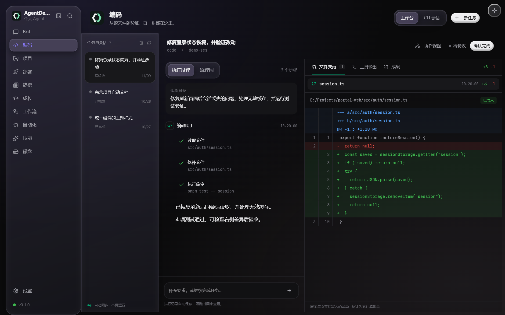
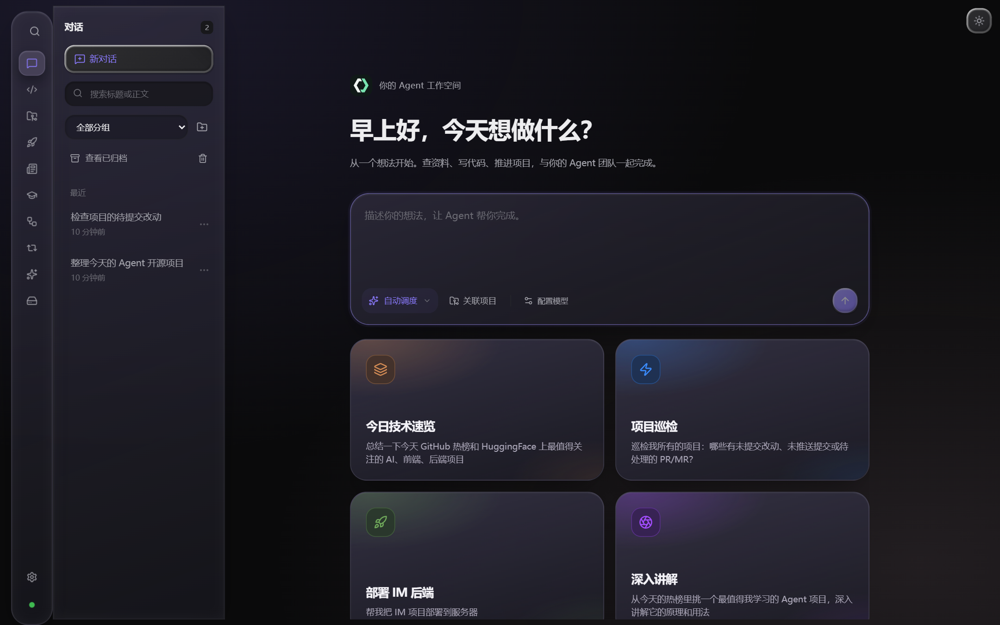
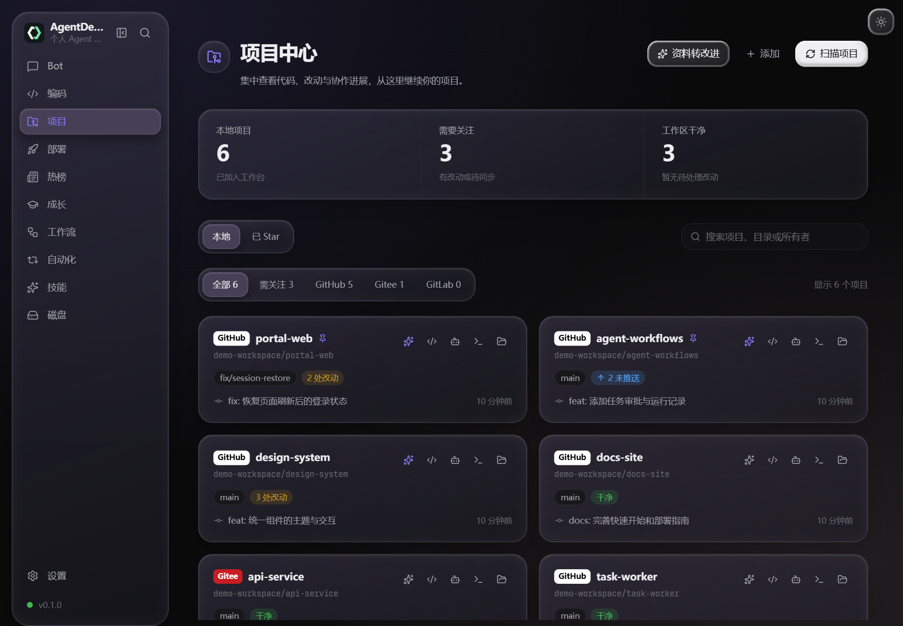
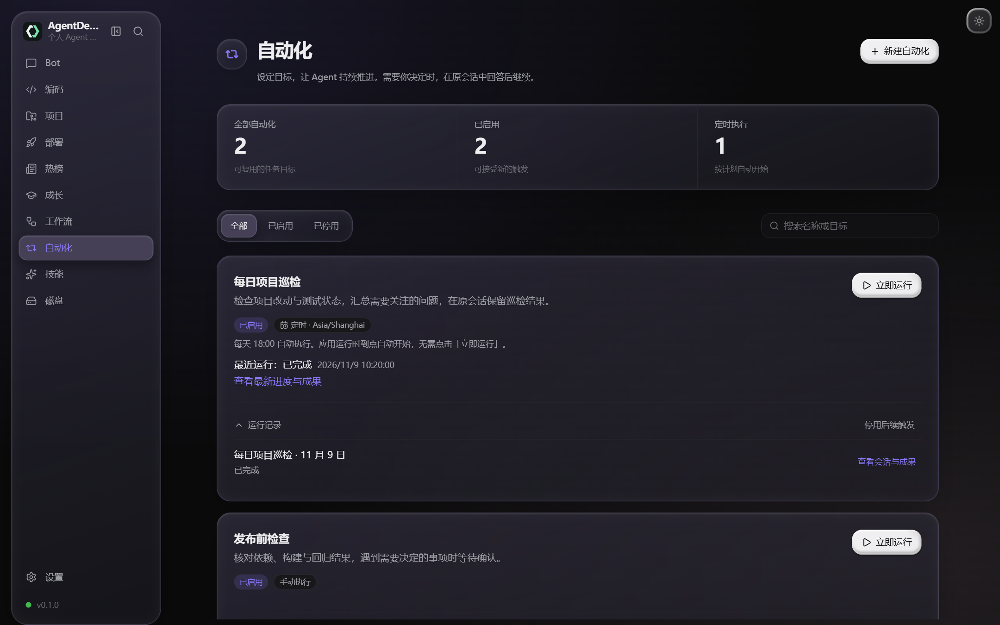
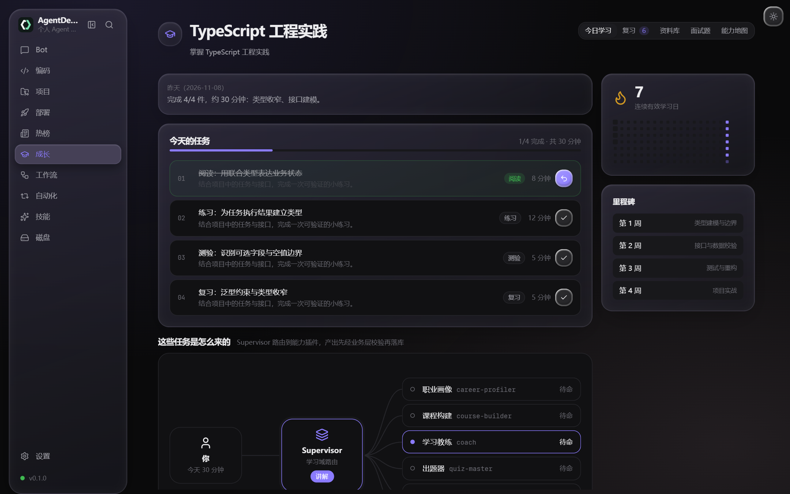
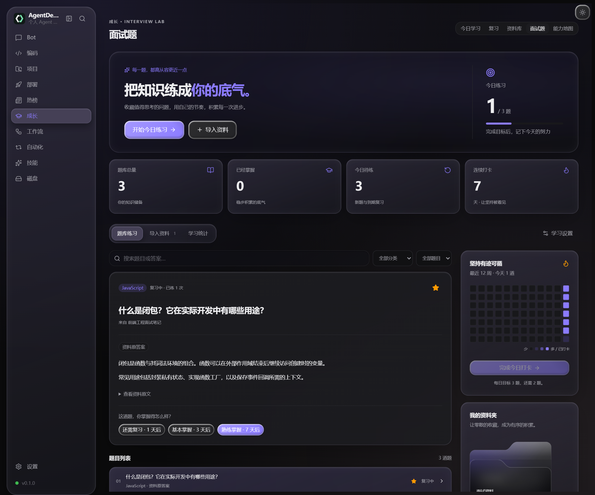
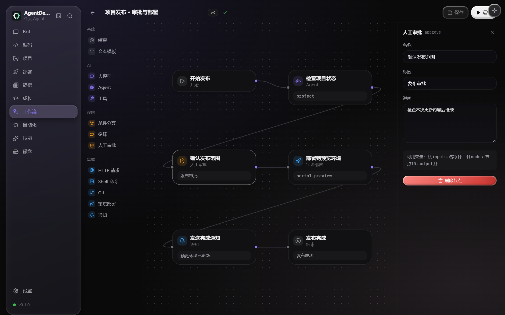
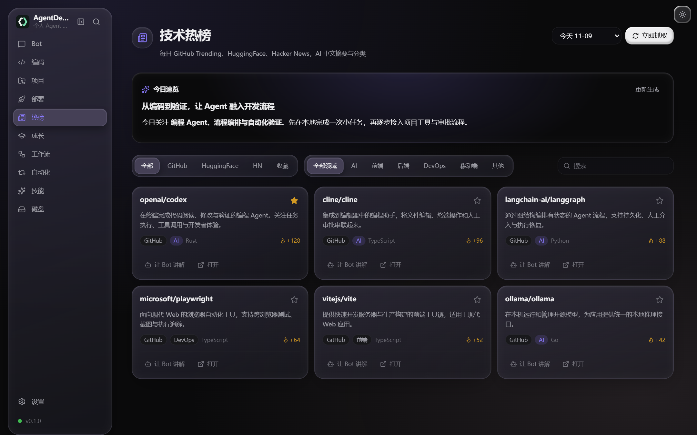
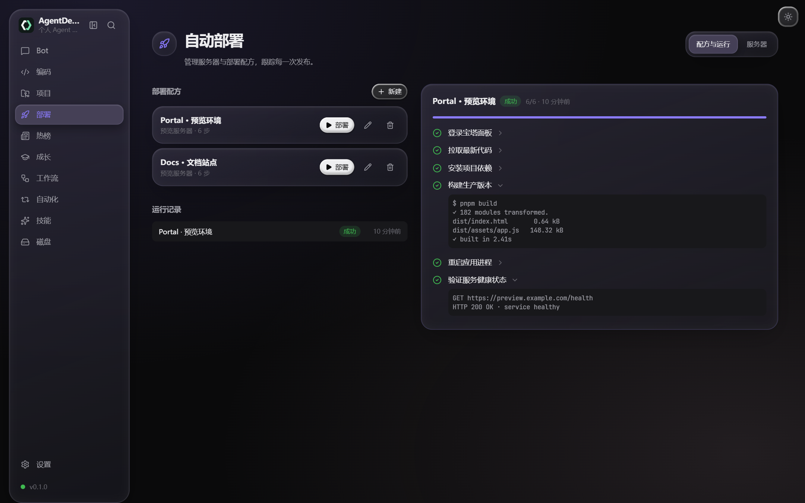

<p align="center">
  
</p>

<h1 align="center">AgentDesk</h1>

<p align="center"><strong>让 Agent 写代码、推进任务，也陪你读懂项目、持续学习。</strong></p>

<p align="center">
  本地优先的个人 Agent 工作台。多 Agent 协作、项目管理、持久化任务与定时自动化，<br />
  连同源码导读、学习计划和面试练习，放在同一处；可选自部署远程工作台。
</p>

<p align="center">
  <a href="https://www.npmjs.com/package/chuxin-agentdesk"></a>
  <a href="https://nodejs.org/">= 22.12" /></a>
  <a href="https://v2.tauri.app/"></a>
  
</p>

<p align="center">
  <a href="#快速开始">快速开始</a> ·
  <a href="#界面预览">界面预览</a> ·
  <a href="#核心能力">核心能力</a> ·
  <a href="apps/cli/README.md">CLI 文档</a> ·
  <a href="#开发与贡献">开发与贡献</a> ·
  <a href="https://github.com/exploitationExplorers/AgentDesk/issues">反馈问题</a>
</p>



> **当前状态**：项目仍在迭代中。桌面打包目标为 Windows；npm 安装提供 CLI 与浏览器工作台，不安装桌面客户端。使用时需自行配置模型服务。当前仓库未提供开源许可证，CLI 标注为 `UNLICENSED`，详见[许可证说明](#许可证)。

## 为什么是 AgentDesk？

当你同时维护 GitHub、Gitee 和公司 GitLab 上的多个项目，工作往往分散在编辑器、终端、浏览器和部署面板中：先找仓库，再检查状态，让 Agent 改代码，切回终端跑验证，最后回看它到底改了什么。

AgentDesk 把这些环节连接起来：**围绕本地项目发起任务，让 Agent 使用真实工具执行，再由你检查过程、审批操作和验收结果。** 它不是托管代码的云端平台，也不要求你放弃已有的编辑器。

- **面向多项目开发者**：集中查看本地仓库、分支、未提交改动和近期提交，再进入具体项目工作。
- **执行过程可见**：不仅看最终回答，也能查看工具记录、命令输出和真实文件差异。
- **保留人的控制权**：需要确认的操作进入审批；持久化任务可停止、续跑和验收。
- **选择自己的模型与入口**：桌面端、浏览器工作台和 CLI 复用同一套引擎；模型地址与凭据由你配置。

除本机工作流外，也可自部署远程工作台：在手机浏览器中管理云端项目，或配对自己的电脑，在授权的项目范围内发起任务、处理审批和检查改动。远程模式需要另行部署网关与 Runner，面向个人使用，部署步骤见 [Linux / 宝塔部署文档](deploy/cloud/README.md)。

近期能力包括：**Agent 协作视图、流式成果预览、持久化自动化、源码导读、成长中心与面试题库，以及手机远程工作台与电脑连接器**。

## 快速开始

### 1. 安装并打开工作台

准备 **Node.js 22.12+** 和 **Git**，无需克隆源码：

```sh
npm install -g chuxin-agentdesk
agentdesk
```

在交互终端中，`agentdesk` 会引导你配置模型，然后选择打开浏览器工作台或进入终端对话。终端对话支持多轮交流、历史续接、模型与主题切换。也可以直接使用：

```sh
agentdesk web       # 打开本机浏览器工作台
agentdesk chat      # 进入交互式终端对话
```

### 2. 配置模型和项目

1. 在初始化向导或工作台设置中，填写模型接口地址、模型名称和 API Key。
2. 在工作台设置中添加项目扫描目录；按需配置 GitHub、Gitee 或 GitLab 的平台 Token。
3. 使用自己的模型完成一轮对话，确认连接可用；保存配置本身不会发起模型推理请求。

CLI 初始化支持 OpenAI Chat Completions 和 Anthropic Messages 协议。模型调用产生的费用、网络连接与服务可用性取决于你选择的服务商。

### 3. 发起第一个任务

可以先从只读盘点开始，再进入代码修改：

```sh
agentdesk chat "梳理本地项目中有哪些未提交改动"
agentdesk run "检查 AgentDesk 项目的 README 与实际功能是否一致，先给出建议"
agentdesk tasks
agentdesk web
```

在「编码现场」查看持久化任务的执行时间线、工具审批和文件差异。**关闭页面或终端不会取消持久化任务；实时聊天断开则会取消当前轮次。** 停止任务使用 `agentdesk cancel <任务ID>`。

<details>
<summary><strong>升级、服务管理与连接方式</strong></summary>

```sh
agentdesk stop
npm install -g chuxin-agentdesk@latest
agentdesk web
```

若已更新安装包，但后台仍运行旧版本，执行 `agentdesk restart` 后再打开工作台。升级时使用原来的数据目录，即可继续使用已有配置与数据库。

```sh
agentdesk status          # 查看本地服务状态
agentdesk doctor          # 诊断运行环境与配置
agentdesk logs --follow   # 跟踪服务日志
agentdesk web --no-open   # 不自动打开浏览器，只打印连接地址
agentdesk --help          # 查看全部命令
```

`web`、`chat`、`run` 等命令会在需要时自动拉起本地服务。浏览器连接地址仅限本机使用，短时有效且只能使用一次，请勿分享。会话失效或服务重启后，重新运行 `agentdesk web` 即可。

完整命令、任务状态与审批用法见 [CLI 文档](apps/cli/README.md)。

</details>

## 界面预览

以下为当前界面使用固定演示数据生成的截图，项目、任务、学习记录和热榜内容均为展示样例。

|                Bot：对话与任务入口                |                 项目：集中管理本地仓库                  |
| :-----------------------------------------------: | :-----------------------------------------------------: |
|  |  |

|                      自动化：定时触发与运行记录                       |                    成长中心：每日计划与学习进度                    |
| :-------------------------------------------------------------------: | :----------------------------------------------------------------: |
|  |  |

|                   面试题：资料导入与复习练习                    |                   工作流：编排可重复流程                   |
| :-------------------------------------------------------------: | :--------------------------------------------------------: |
|  |  |

<details>
<summary><strong>查看技术热榜与部署面板</strong></summary>





</details>

## 核心能力

### 编码任务：从目标到可检查的改动

- 创建任务，在同一处查看时间线、命令输出与文件差异。
- 处理工具审批、停止执行、接续失败任务，并检查和验收结果。
- 持久化任务由本地后台服务执行，不依赖页面一直打开；服务重启后，中断任务可按状态续跑，并非无缝恢复进程。
- 使用原生文件与命令工具完成编码，也可在安装并配置相应工具后打开 Cursor、终端或 Claude Code。
- 切换协作视图，检查 Agent 委派关系与执行进度；在成果面板查看生成内容和文件预览。
- 在编码页切换工作台任务与 CLI 会话，查看各自的执行记录。

### 项目管理：连接多平台，围绕本地仓库工作

- 扫描本地 Git 仓库，查看分支、未提交改动和最近提交。
- 查看 PR/MR，从 GitHub、Gitee 导入项目，按平台配置相应凭据。
- 借助 AI 生成提交说明；提交、推送等操作仍需按具体权限与审批流程执行。

### Bot 与工具：对话不止于回答

- 总控 Agent 将工作交给项目、编码、部署和研究等专门 Agent。
- 调用本地工具读取文件、修改代码、执行命令或操作浏览器；需要确认的操作进入审批。
- 查看浏览器实况，并在登录、验证码等场景中人工接管。
- 通过跨平台研究工具检索外部资料，并结合技术热榜获取线索。

### 自动化：设定目标，按计划持续推进

- 将巡检、资料整理等目标保存为可复用自动化，手动触发或按时间与时区定时执行。
- 为任务指定工作目录，并设置轮数、时长及可选的 Token、费用预算。
- 在原会话回答问题、处理授权并查看成果；运行记录可回看，也可停用后续触发。
- 定时任务需要宿主服务保持运行。当前 Autoloop 发行目标为 Windows x64；Linux cloud 镜像关闭此运行时，详见 [Autoloop runtime 文档](packages/autoloop-runtime/README.md)。

### 源码导读与成长中心：把理解和练习留在工作流里

- 在 Bot 中提出「带我读懂这个仓库」，对已登记的本地项目或公开 GitHub 仓库逐段阅读，并保存导读进度以便继续。
- 根据职业目标和每日可投入时间建立能力地图、学习计划与里程碑，跟踪每日任务和打卡记录。
- 导入链接或正文，整理知识点并按复习队列练习；导入内容和生成结果保留来源线索。
- 面试题支持批量导入文件、链接和粘贴正文，保留资料原答案，缺失答案由 AI 补齐并标明来源；支持收藏、掌握度、到期复习、每日目标和学习统计。

### 远程工作台：在手机上继续项目任务

- 自部署网关与 Runner，使用邮箱验证码登录，在手机浏览器中导入项目、发起任务、查看回放和处理审批。
- 通过 CLI 电脑连接器进行双方确认的配对，仅授权选定的本地项目；支持查看连接状态和撤销设备。
- 对选定文件提交、推送，或将电脑上的未提交改动取回到新的云端工作区；各步骤按权限与审批执行。
- 远程入口与本机 `agentdesk web` 分开配置；详见 [部署与电脑配对](deploy/cloud/README.md)。

### 工作流、部署与技术发现

- **可视化工作流**：通过画布连接模型、工具与审批，组织可重复执行的流程。
- **部署配方**：按配方在宝塔环境执行部署，查看步骤结果并重试失败步骤；服务器与凭据需自行配置。
- **技术热榜**：汇总 GitHub、Hugging Face 和 Hacker News 的技术动态，内容获取依赖外部网络。

### 技能与记忆：扩展自己的工作方式

- 使用 `SKILL.md` 描述任务步骤，扩展个人工作流。
- 保存稳定偏好、事实和决定，并在后续对话中召回或删除。
- 自定义技能放在实际数据目录的 `skills/<name>/SKILL.md`，私有技能不应提交到公开仓库。

> 微信群聊日报属于可选私有技能，默认关闭，不随公开安装包提供；不能仅通过打开环境变量获得完整能力。

## 运行方式与数据

### 选择入口

| 方式             | 如何启动                           | 适用场景                                 | 数据与边界                                                 |
| ---------------- | ---------------------------------- | ---------------------------------------- | ---------------------------------------------------------- |
| 浏览器工作台     | npm 安装后运行 `agentdesk web`     | 不安装桌面客户端，直接查看项目与执行现场 | 与同一实例的 CLI 共用数据，仅限本机连接                    |
| CLI              | `agentdesk chat` / `agentdesk run` | 终端对话、持久化任务、脚本集成           | 默认实例根目录为 `~/.agentdesk`                            |
| Windows 桌面端   | 独立安装包或源码启动               | 独立桌面窗口与系统集成                   | Windows 默认数据目录为 `%APPDATA%\AgentDesk\`，与 CLI 独立 |
| 自部署远程工作台 | 部署网关与 Runner，通过 HTTPS 访问 | 手机管理云端项目或已配对电脑上的项目     | 需要域名、SMTP 与服务器；电脑项目需显式配对授权            |

桌面端与 CLI 复用引擎，但**不自动同步数据库、模型设置和任务**，需要分别初始化。当前桌面打包配置只包含 Windows NSIS，不代表已提供 macOS/Linux 桌面发行版。

CLI 默认监听 `127.0.0.1:17891`。使用 `--data-dir <目录>` 或 `AGENTDESK_CLI_HOME` 修改 CLI 实例根目录时，每条命令都应指向同一目录；数据库、用户技能和浏览器资料保存在该根目录下的 `data/` 中。

### 安全与隐私

**本地优先不等于完全离线。** 数据库、任务记录、凭据存储和浏览器登录态保存在本机，但调用远程模型时，相关提示词、项目上下文与工具结果可能发送给所配置的服务商。Git 平台、热榜与部署操作也会访问相应的外部服务。

- **本地服务**：界面通过 HTTP/SSE 连接监听 `127.0.0.1` 的 sidecar，使用令牌认证。不要把本地端口直接暴露到公网。
- **凭据存储**：凭据以 AES-256-GCM 加密保存在本地数据库中；桌面模式使用系统钥匙串保护主密钥，CLI 使用本地密钥文件。加密不能替代本机账号与文件权限保护。
- **操作审批**：需要确认的工具操作会生成审批。审批前检查命令、路径和目标环境，不应仅凭模型描述授权。
- **敏感资料**：不要提交 API Key、平台 Token、数据库、浏览器登录态、私有技能或含敏感信息的日志。API Key 和 Token 应在设置中填写，**不要放入 `VITE_*`**，这类变量会编译进前端。
- **备份与迁移**：数据目录包含凭据和登录资料。复制、分享或备份前按敏感数据处理；修改数据目录不会自动迁移旧数据。

## 配置参考

普通 npm 用户优先使用 `agentdesk init`、工作台设置和 CLI 参数。源码开发可复制 [`.env.example`](.env.example) 为 `.env`；CLI 不自动读取源码仓库的 `.env`。

| 变量                              | 用途                                                       |
| --------------------------------- | ---------------------------------------------------------- |
| `AGENTDESK_CLI_HOME`              | CLI 实例根目录，默认 `~/.agentdesk`；也可使用 `--data-dir` |
| `AGENTDESK_DATA_DIR`              | sidecar 实际数据目录，包含数据库、技能和浏览器资料         |
| `AGENTDESK_SKILLS_DIR`            | 指定技能加载目录，适合源码开发或私有技能                   |
| `AGENTDESK_PORT`                  | sidecar 监听端口；桌面模式由外壳注入                       |
| `AGENTDESK_TOKEN`                 | 本地 API 令牌；桌面模式每次启动生成                        |
| `AGENTDESK_ALLOWED_ORIGINS`       | 额外允许的界面来源，以逗号分隔；不是远程访问开关           |
| `AGENTDESK_WECHAT_REPORT_ENABLED` | 是否启用已安装的私有微信日报能力，默认关闭                 |

源码 sidecar 的环境变量优先级：系统环境变量 → 数据目录 `.env` → `apps/sidecar/.env` → 仓库根目录 `.env`。CLI 仅读取实例根目录及其 `data/` 下的 `.env`。

## 开发与贡献

### 本地开发

准备 Node.js 22.12+、Git 和 pnpm 10（仓库声明版本为 `10.33.3`）。桌面开发和打包另需 Rust、Windows MSVC 工具链及 Tauri 的平台前置依赖，参见 [Tauri 开发环境说明](https://v2.tauri.app/start/prerequisites/)。

```sh
git clone https://github.com/exploitationExplorers/AgentDesk.git
cd AgentDesk
pnpm install
```

以下环境文件复制命令使用 PowerShell，其他 shell 请使用对应的复制命令：

```powershell
Copy-Item .env.example .env
```

**只调试浏览器界面**，在两个终端分别运行：

```sh
# 终端 1：本地 API
pnpm dev:sidecar   # http://127.0.0.1:17890

# 终端 2：前端开发服务器
pnpm dev:web       # http://localhost:1420
```

**桌面开发**：

```sh
pnpm --filter @agentdesk/desktop app:dev
```

**构建并试运行 CLI**（包含 Autoloop 与 Supervisor，构建机需要 Rust 工具链）：

```sh
pnpm build:cli
pnpm cli --help
pnpm cli web
```

CLI 包含 `better-sqlite3` 原生依赖；目标环境没有匹配的预编译文件时，需要相应平台的构建工具。浏览器工具使用 `playwright-core`，不会自动下载浏览器，需本机有可用的 Chrome 或 Edge。

### 项目结构

```text
AgentDesk/
├── apps/
│   ├── desktop/          # Tauri 2 + React，桌面外壳与工作台前端
│   ├── sidecar/          # Node.js + Hono + SQLite，本地服务
│   ├── cloud-gateway/    # 远程登录、设备连接与请求转发
│   └── cli/              # CLI、后台服务管理与浏览器工作台入口
├── packages/
│   ├── agent-core/       # Agent 核心能力
│   ├── integrations/     # 外部服务与工具集成
│   ├── autoloop-runtime/ # 持久化自动化运行时与进程管理
│   ├── shared/           # 共享类型与契约
│   ├── ui/               # 共享 UI
│   └── workflow/         # 工作流能力
├── assets/screenshots/   # README 演示截图，可随仓库分发
├── deploy/cloud/         # Linux / 宝塔远程部署包与操作文档
├── docs/                 # 本机工程笔记，不纳入公开仓库
└── scripts/              # 开发与安全检查脚本
```

### 验证与提交

按改动范围运行相关检查；涉及前端交互时补充 E2E 验证：

```sh
pnpm typecheck
pnpm lint
pnpm test
pnpm --filter @agentdesk/desktop e2e
pnpm build
```

更新展示图时，运行 `pnpm --filter @agentdesk/desktop screenshots`。脚本只启动 Vite，使用固定演示数据拦截 API，不启动 sidecar 或调用真实模型；通过系统 Edge 截取当前界面，将图片写入 `assets/screenshots/`。可用 `E2E_BROWSER_CHANNEL` 指定已安装的 Chrome。演示数据与截图断言分别维护在 [`readme-fixtures.ts`](apps/desktop/scripts/readme-fixtures.ts) 和 [`capture-readme.ts`](apps/desktop/scripts/capture-readme.ts)。

提交说明采用 [Conventional Commits](https://www.conventionalcommits.org/zh-hans/v1.0.0/)，例如 `docs: improve quick start` 或 `fix: handle task cancellation`。提交钩子会检查私有文件与常见格式的密钥；公开代码或发布前，再运行：

```sh
pnpm security:check --history
```

欢迎通过 [Issues](https://github.com/exploitationExplorers/AgentDesk/issues) 反馈缺陷、提出功能建议或先讨论较大的改动。缺陷报告请附带运行入口（桌面 / 浏览器 / CLI）、系统与 Node.js 版本、复现步骤、预期结果和脱敏日志。PR 请说明修改动机、涉及范围与实际执行的验证；不要附带密钥或真实业务数据。参与前请留意下方许可证状态。

<details>
<summary><strong>Windows 桌面打包与更新签名</strong></summary>

以下命令使用 PowerShell；签名私钥必须放在仓库外并妥善保管：

```powershell
pnpm --filter @agentdesk/desktop tauri signer generate -w C:\private\agentdesk.key
$env:TAURI_SIGNING_PRIVATE_KEY = Get-Content -Raw 'C:\private\agentdesk.key'
pnpm --filter @agentdesk/desktop app:bundle
```

安装包输出到 `apps/desktop/src-tauri/target/release/bundle/nsis/`。发布前需核对 [`tauri.conf.json`](apps/desktop/src-tauri/tauri.conf.json) 中的更新公钥与更新地址；当前地址仍是占位配置，不能据此假定自动更新已可用。不要将签名私钥提交到仓库。

CLI 发布前的构建、发行包与仓库外安装验证见 [CLI 发行验证](apps/cli/README.md#发行验证)。

</details>

## 常见问题

### npm 安装后为什么没有桌面客户端？

npm 包提供终端入口和浏览器工作台。运行 `agentdesk web` 即可使用图形界面；独立桌面应用需要另行安装或从源码构建。

### 桌面端配置过模型，为什么 CLI 还要配置？

两者默认使用不同数据目录，不自动同步。CLI 与它打开的浏览器工作台才共享同一实例的数据。

### 模型配置成功，但聊天失败怎么办？

配置保存并不代表完成模型调用验证。先运行 `agentdesk doctor`，再核对接口协议、Base URL、模型名称、Key 权限和网络连接；如需排查服务端错误，查看 `agentdesk logs --follow`，分享日志前先脱敏。

### 关闭窗口后，任务还会继续吗？

`run` 创建的持久化任务会继续由后台服务执行，关闭页面或终端只会停止查看；实时聊天断开会取消当前轮次。服务退出会中断运行中的任务，重新启动后可检查状态并对失败或已取消任务使用 `resume`，不能把“持久化”理解为服务退出后仍在执行。

### 可以从另一台电脑访问，或者给团队共用吗？

可以自部署 [远程工作台](deploy/cloud/README.md)，通过 HTTPS 和邮箱验证码登录，在手机访问云端项目，或配对自己的电脑后操作授权项目。电脑需要保持开机联网。当前部署面向单个所有者，不提供通用团队账号体系；本机 `agentdesk web` 的一次性连接地址仍仅限本机使用。

## 许可证

当前仓库未包含 `LICENSE` 文件，CLI 的 `package.json` 标注为 **`UNLICENSED`（保留权利）**。源码可见不等于已按开源许可证授权；在明确许可证之前，不应假定可以自由使用、修改或分发。第三方依赖仍遵循各自的许可证。
