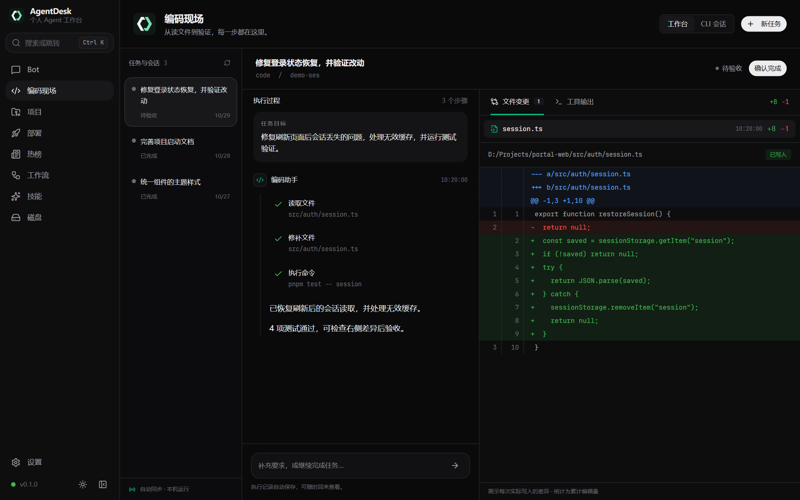
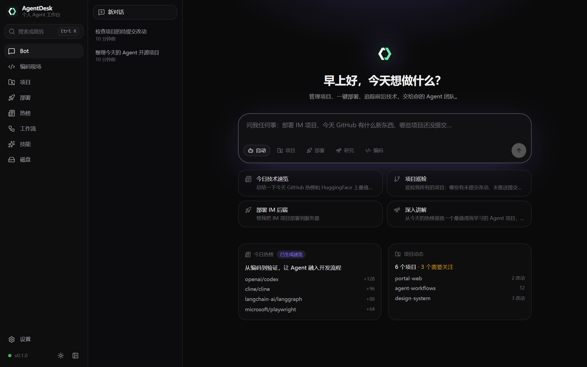
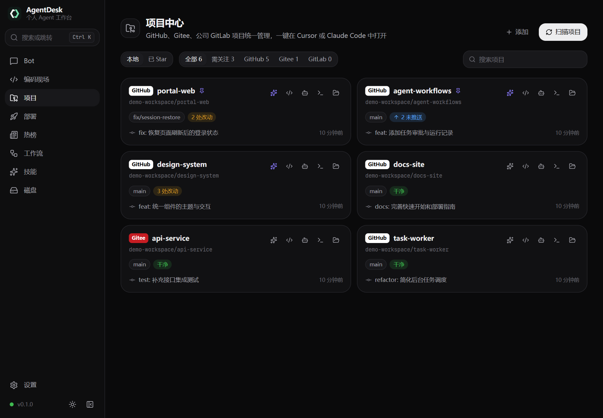
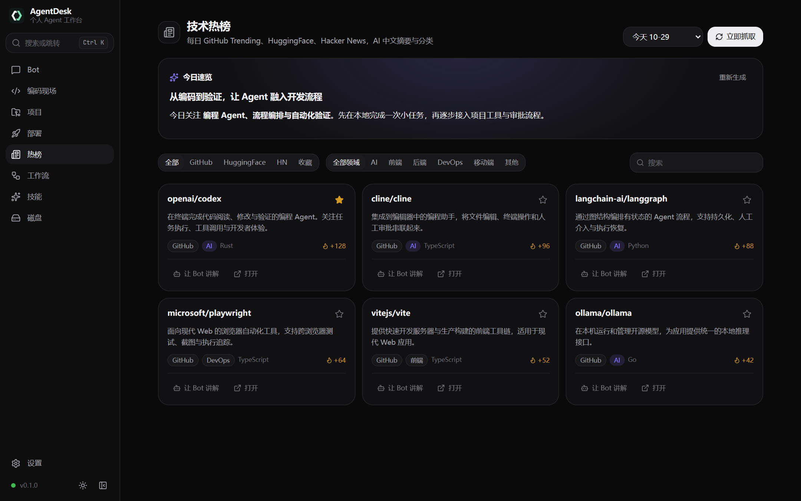
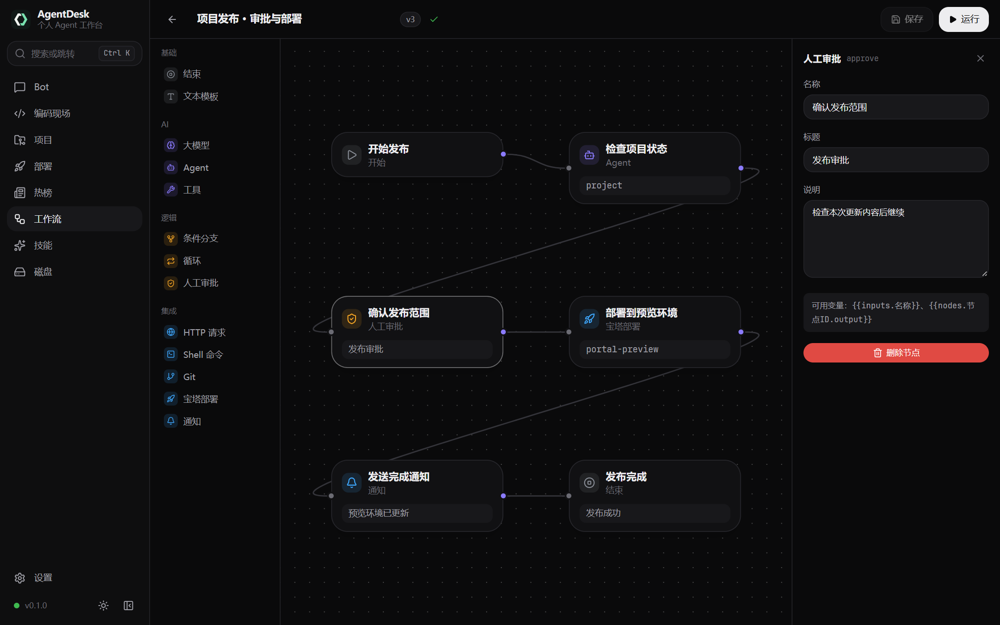
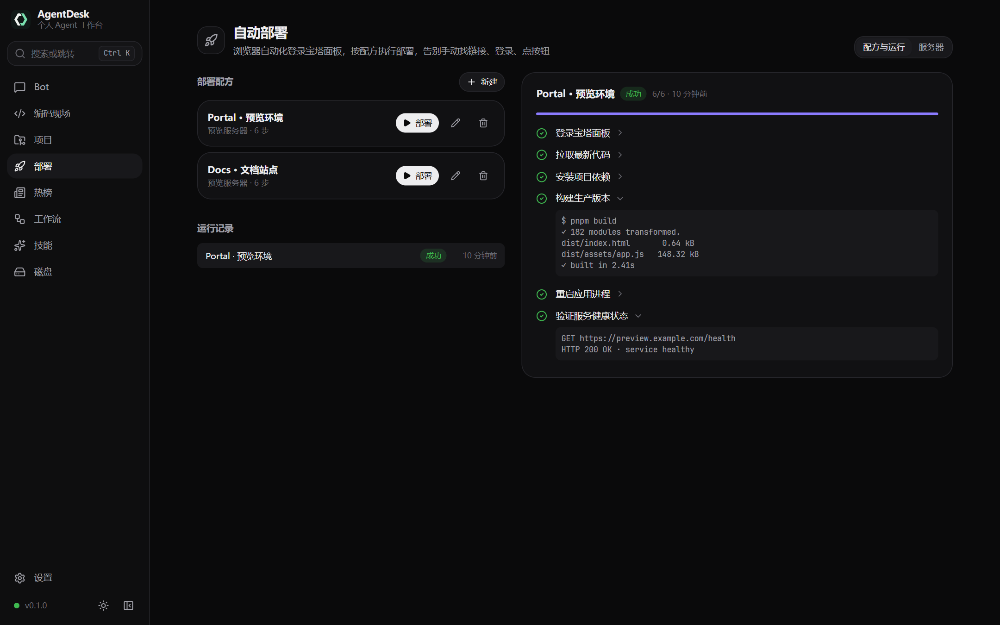

<p align="center">
  
</p>

<h1 align="center">AgentDesk</h1>

<p align="center">个人 Agent 工作台 · 本地编码 · 可视化执行</p>

让 Agent 读取和修改项目代码，在编码现场查看每一步工具调用、文件差异与验证结果。

一个运行在本机的 Agent 桌面应用：统一管理 GitHub / Gitee / GitLab 项目，通过 AI 辅助提交代码、操作浏览器和执行部署，定时汇总技术热榜，并用可视化工作流串联日常开发任务。支持长期记忆、GitHub 已 Star 项目浏览、磁盘清理和自定义 Skills。

当前桌面打包流程面向 Windows，同时提供复用同一引擎的独立本地 CLI。AI 模型、Git 平台账号和服务器由使用者自行配置；CLI 包尚未公开发布，当前通过源码构建使用。

## 文档导航

- [功能与常用操作](#功能)：项目管理、原生编码、审批、部署与工作流
- [快速开始](#快速开始)：桌面开发、浏览器调试与独立 CLI
- [本地配置与数据](#本地配置与数据)：环境变量、数据目录与密钥保护
- [扩展 Skills](#扩展-skills)：公开内置技能与可选私有扩展
- [架构](#架构) / [开发与检查](#开发与检查) / [打包 Windows 安装包](#打包-windows-安装包)
- [常见问题](#常见问题) / [开源与私有内容](#开源与私有内容)
- [CLI 完整说明](apps/cli/README.md) / [终端外观与动效](apps/cli/TERMINAL.md)

## 界面预览

截图来自当前前端，使用演示项目、任务、榜单与运行记录（2026-10-29）。

**编码现场 · 从任务到代码差异**

任务列表、执行时间线与文件差异并排展示，可切换查看命令输出，在同一页面完成审批、补充要求与验收。



**Bot · 多 Agent 对话入口**



|                  项目中心                  |                技术热榜                |
| :----------------------------------------: | :------------------------------------: |
|  |  |

|                  可视化工作流                  |               宝塔自动部署               |
| :--------------------------------------------: | :--------------------------------------: |
|  |  |

<details>
<summary>更新界面截图</summary>

安装依赖及 Microsoft Edge 后，在仓库根目录运行：

```bash
pnpm --filter @agentdesk/desktop screenshots
```

脚本启动当前 Vite 前端，用固定演示数据生成以上 6 张截图，输出到 `docs/screenshots/`。无需启动 sidecar 或配置模型；使用 Chrome 时设置环境变量 `E2E_BROWSER_CHANNEL=chrome`。

</details>

## 功能

| 模块           | 能力                                                                                                                       |
| -------------- | -------------------------------------------------------------------------------------------------------------------------- |
| Bot            | 总控 + 项目 / 部署 / 研究 / 编码 Agent，流式回答、工具调用、操作审批、相关长期记忆召回                                     |
| 编码现场与任务 | 桌面创建编码任务，查看执行时间线、实际文件差异与工具输出，处理审批、停止、续跑与验收；CLI 支持持久化任务与断线补看         |
| 原生编码       | 直接读取、搜索、精确修改项目文件并执行验证；保留真实编辑差异，按需使用本机 Claude Code                                     |
| 项目中心       | 扫描本地仓库，查看分支、未提交、未推送、PR/MR、提交记录和 Star 数；打开 Cursor / Claude Code / 终端，查看 Claude Code 会话 |
| AI 提交        | 根据仓库改动生成 Conventional Commits 提交说明，支持编辑说明、暂存全部改动、仅提交或提交并推送；后台任务展示执行结果       |
| 仓库导入与收藏 | 从 GitHub / Gitee 选择远程仓库并关联本地克隆或克隆到扫描目录；浏览 GitHub 已 Star 项目、搜索、克隆并交给研究 Agent 讲解    |
| 浏览器与部署   | 浏览器实况面板、登录态复用和人工接管；宝塔服务器档案、部署配方、逐步日志与截图、失败步骤重试                               |
| 技术热榜       | GitHub Trending、Hugging Face、Hacker News，LLM 中文摘要、领域分类、每日速览和定时刷新                                     |
| 工作流         | React Flow 画布，14 类节点，支持模型、Agent、工具、条件、循环、HTTP、Shell、Git、部署、审批和通知，手动或定时运行          |
| 技能           | 独立技能目录页与 `SKILL.md` 渐进加载；公开内置技能可在 Bot 中使用，具体扩展可提供独立运行界面                              |
| 长期记忆       | 显式记住或忘记信息，自动提取稳定偏好、事实和决定，后续对话按相关性召回；在设置中查看和删除                                 |
| 磁盘           | 空间概览、低空间提醒、扫描与分级建议；确认后清理勾选项，保护代码仓库、应用数据等路径                                       |
| 设置           | 导入 CC Switch / `.env` 中的模型配置、拉取模型列表、Agent 模型绑定与备用模型、Git Token、代理、扫描目录、头像和主题        |

### 常用操作

**在编码现场完成任务**

1. 进入「编码现场」，选择任务来源和已登记的本地项目；尚未登记的仓库可通过「添加本地项目」填写路径。
2. 描述目标与验证要求，例如「完善 README，核对启动命令并检查文档链接」，然后开始编码。
3. 在执行时间线查看读取、搜索、编辑和命令步骤；在右侧查看每次实际写入的文件差异或工具输出。
4. 出现审批或补充问题时，检查详情后批准、拒绝或填写回答；执行中可显式停止任务。
5. 任务结束后检查改动和验证结果。处于待验收状态时可「确认完成」，需要调整时补充要求；失败或停止后可继续任务。

文件差异展示的是各次实际写入记录，增删统计为累计编辑量，不等同于最终 `git diff`。提交和推送仍需另行确认，不会因为任务完成而自动进行。

原生编码直接使用文件工具读取、搜索和修改源码，并通过命令运行测试或构建，不要求安装 Claude Code。只有需要使用本机 Claude Code 时才需准备对应 CLI 与认证。普通 Bot 对话与持久化任务的生命周期不同；需要离开页面后继续执行的工作，优先使用编码任务或 CLI 的 `run`。

**管理与提交项目**

在「设置 → 通用」添加扫描目录并保存，到「项目」点击「扫描项目」。可按 Git 平台或「需关注」筛选仓库，也可点击「添加」从 GitHub / Gitee 导入远程仓库。

点击项目的「AI 提交推送」后，先查看改动摘要和 AI 生成的提交说明，再编辑并确认。已有暂存改动时按暂存内容提交；暂存区为空时，界面会提示暂存全部改动。可以关闭推送只保留本地提交，也可以在工作区干净时推送已有的本地提交。执行过程通过后台任务查询结果。

AI 生成提交说明需要可用模型。实际的 `git commit` / `git push` 还依赖本机 Git 配置、仓库提交钩子以及 SSH 或 Git 凭据；应用中的平台 Token 用于平台 API，Git 推送认证需在本机配置。

**浏览已 Star 项目**

配置 GitHub Token 后，在「项目 → 已 Star」查看最近更新的最多 100 个仓库，按名称、描述或语言搜索。可以克隆到扫描目录，也可以让研究 Agent 讲解用途和代码阅读入口。

**使用长期记忆**

在 Bot 中说「记住：我偏好使用 TypeScript」或「忘掉这条偏好」。助手也会从成功对话中提取适合长期保留的信息，并在后续对话中召回相关内容。在「设置 → 记忆」查看来源、类型和时间，或直接删除条目。模型不可用或提取失败时，不影响已完成的对话。

**清理磁盘**

进入「磁盘」查看空间并扫描，检查「首要清理」「需要你决定」和保留项，再确认清理选中的内容。扫描本身不删除文件，AI 建议受本地规则和保护路径限制。首要清理项会直接删除；需要自行决定的项目默认移入回收站，也可在设置中改为直接删除。

低空间提醒的默认阈值为 15 GB，可在「设置 → 通用」调整。关闭提醒后，6 小时内不会再次弹窗。

**通过 Bot 操作浏览器与工作流**

可让编码 Agent 阅读网页、操作浏览器或调用 Claude Code 修改本地项目。浏览器实况面板展示当前页面，需要登录或验证码时点击「接管」。工作流支持通过界面运行，也可以让 Bot 查询并运行已有流程。自定义业务流程所需的项目路径、账号与技能由使用者自行准备。

## 快速开始

### 独立 CLI

独立 CLI 可在本机构建运行，提供本地服务、模型配置、交互聊天和持久化任务。包名 `@agentdesk/cli` 尚未公开发布。安装和命令见 [CLI 说明](apps/cli/README.md)。

```powershell
pnpm build:cli
pnpm cli
pnpm cli run "梳理还没提交的项目"
pnpm cli tasks
pnpm cli stop
```

在真实交互终端里直接执行 `pnpm cli`：已经配置模型时进入聊天；还没有模型时先完成配置，再进入聊天。脚本和非交互环境仍打印帮助。

`init`、`chat`、`run`、`tasks`、`inspect`、`cancel`、`resume` 以及审批命令在服务未运行时会自动在后台拉起服务。`start`、`stop`、`restart`、`status` 只管理服务本身。

CLI 默认数据目录是 `~/.agentdesk`，端口是 `17891`，与桌面端的数据和端口分开。`chat` 断开连接会取消当前这一轮对话。`run` 创建的任务由本地服务继续执行，关闭终端不会取消；停止任务需要 `pnpm cli cancel <任务ID>`。使用与项目原生数据库依赖匹配的 Node 版本，新环境安装依赖时由目标平台准备原生模块。

### 开发环境

- Node.js 22+、pnpm 10 和 Git。项目指定的 pnpm 版本见 `package.json`。
- 完整桌面开发还需要 Rust、Windows MSVC 工具链及 Tauri 所需系统依赖；只调试浏览器 UI 时不需要构建 Rust 外壳。
- 浏览器自动化需要系统 Edge 或 Chrome，默认使用 Edge，可在设置中选择。
- 使用 Cursor / Claude Code 功能时，需自行安装对应工具，并在「设置 → 通用」配置可用的命令。

```powershell
pnpm install

# 本地配置模板：默认关闭微信日报，不含真实密钥
Copy-Item .env.example .env

# 方式一：完整桌面应用，Rust 外壳自动启动 sidecar
pnpm --filter @agentdesk/desktop app:dev
```

浏览器调试时，在两个终端分别启动：

```powershell
# 终端一：http://127.0.0.1:17890
pnpm dev:sidecar

# 终端二：http://localhost:1420
pnpm dev:web
```

如果切换 Node 版本后出现 `NODE_MODULE_VERSION` 不匹配，需要在当前 Node 版本下重新安装或重建 `better-sqlite3`，并重新构建 sidecar。

### 首次配置

1. **设置 → 模型 Provider**：手动添加模型，或从自己的 CC Switch / `.env` 导入。点击「测试」确认可用，中转站可通过「获取可用模型」选择支持的模型。
2. **设置 → Agent 模型**：为总控与专用 Agent 绑定模型，按需配置备用 Provider。
3. **设置 → Git 平台**：配置自己的 GitHub / Gitee / GitLab Token，GitLab 需填写对应域名。
4. **设置 → 通用**：添加项目扫描目录，确认 Cursor / Claude Code 命令、代理、浏览器、热榜刷新时间和磁盘设置。
5. **项目**：扫描本地仓库，或从远程导入；尝试查看仓库状态、AI 提交和 GitHub 已 Star 项目。
6. **部署 / 工作流**：按需添加自己的服务器与配方、配置工作流输入，再确认运行。

可以在 Bot 中尝试：「哪些项目还没提交」「今天热榜有什么值得看的」「记住我偏好深色界面」「看看磁盘还有多少空间」。

网络代理依次使用：设置中的代理 → `HTTPS_PROXY` 环境变量 → Windows 系统代理。热榜到达配置时间后自动刷新；错过时间时会在下次启动后补跑，调度需要 sidecar 运行。

## 本地配置与数据

### 环境变量

将根目录的 [`.env.example`](.env.example) 复制为 `.env` 后按需修改，重启应用生效。AI API Key 与 Git 平台 Token 在应用设置中管理。

| 变量                              | 默认值 / 行为             | 用途                                                              |
| --------------------------------- | ------------------------- | ----------------------------------------------------------------- |
| `AGENTDESK_WECHAT_REPORT_ENABLED` | `false`，只有 `true` 开启 | 启用可选的私有微信日报扩展                                        |
| `AGENTDESK_DATA_DIR`              | 平台默认数据目录          | 指定数据库、任务、技能和浏览器登录态等本地数据的位置              |
| `AGENTDESK_SKILLS_DIR`            | 内置技能目录              | 替换源码运行时的内置技能扫描目录，数据目录中的 `skills/` 仍会加载 |
| `AGENTDESK_PORT`                  | 独立运行时为 `17890`      | sidecar 端口，桌面模式由 Tauri 选择并注入                         |
| `AGENTDESK_TOKEN`                 | 独立调试时为空            | 本地 API 会话令牌，桌面模式由 Tauri 每次启动生成并注入            |
| `AGENTDESK_ALLOWED_ORIGINS`       | 在默认允许来源之外追加    | 额外允许的 UI 来源，多个地址用逗号分隔                            |

配置优先级：系统环境变量 → 数据目录 `.env` → `apps/sidecar/.env` → 仓库根目录 `.env`。桌面外壳注入的变量也优先于 `.env`。

sidecar 的这些配置在运行时读取，构建脚本不复制 `.env`。`VITE_*` 属于前端构建变量，会被编译进前端，请勿用它们保存 AI Key、平台 Token 或私钥。

### 数据存储与密钥

Windows 默认数据目录为 `%APPDATA%\AgentDesk\`，可在「设置 → 通用」查看实际路径，或通过 `AGENTDESK_DATA_DIR` 修改。这里保存数据库、对话、记忆、任务、浏览器登录态及自定义技能，公开发布时不要打包整个数据目录。

桌面模式使用系统钥匙串保存主密钥，AI Key、Git 平台 Token 和服务器密码等凭据以 AES-256-GCM 密文保存在数据库中，相关列表接口只返回是否配置或脱敏信息。单独运行 sidecar 或系统钥匙串不可用时，使用数据目录中的 `dev-master.key` 作为本地密钥文件，也需妥善保管。

对话、记忆和报告等业务数据不属于密钥加密范围。调用 AI 时，会向选用的模型服务发送所需对话或分析内容；备份和分享前请检查其中的个人或项目资料。

## 扩展 Skills

将技能放入数据目录的 `skills/<name>/SKILL.md`，Windows 默认为 `%APPDATA%\AgentDesk\skills\<name>\SKILL.md`，重启后加载。Frontmatter 支持 `name`、`description`、`version`、`agents`、`triggers` 和 `allowed_tools`。

在「技能」页面浏览已加载的技能，也可在「设置 → 技能」查看描述与触发词。系统提示先加载名称和描述，命中触发词或调用 `skills.load` 时再加载完整指令。公开内置技能主要通过 Bot 使用，独立运行界面由具体扩展提供。

公开内置示例位于 [`apps/sidecar/skills/`](apps/sidecar/skills/)：

| 技能             | 用途           |
| ---------------- | -------------- |
| `project-triage` | 项目状态梳理   |
| `bt-deploy`      | 宝塔部署辅助   |
| `tech-explain`   | 技术与项目讲解 |

公开安装包仅包含 [`public-skills.ts`](apps/sidecar/scripts/public-skills.ts) 中明确允许分发的技能。自定义技能放到用户数据目录；新增公开内置技能时，需要同时更新该列表。

### 可选的微信群聊日报

微信群聊日报默认关闭。关闭时不注册相关 API、不显示该技能入口，Agent 也不加载该技能。微信 skill 包属于私有扩展，开源仓库和公开安装包不包含该包。

拥有私有 skill 的使用者可以在自己的 `.env` 中开启：

```dotenv
AGENTDESK_WECHAT_REPORT_ENABLED=true
```

将私有包安装到数据目录的 `skills/wechat-daily-report/`，并按该包的要求准备运行环境后重启。仅开启开关不会自动安装技能或准备微信数据。源码运行时也可用 `AGENTDESK_SKILLS_DIR` 指定本机技能目录；安装版推荐使用数据目录中的 `.env` 与 `skills/`。

私有技能就绪后，可从「技能 → 微信群聊日报」进入操作界面。私有包、微信解密数据、聊天原文和生成报告均应保留在本机。

## 架构

```text
apps/
  desktop/        Tauri 2 + React 19 + Vite + Tailwind v4
    src/          TanStack Router/Query、Zustand、React Flow 与功能界面
    src-tauri/    系统钥匙串、sidecar 生命周期、托盘、通知、自动更新
  sidecar/        Node + Hono 本地服务、SQLite、任务与运行、项目与部署、记忆、磁盘、调度
  cli/            独立 CLI、交互终端、本地服务管理与持久化任务入口
packages/
  agent-core/     pi-ai Agent 循环、Orchestrator、工具注册与审批、Skills、模型故障切换
  workflow/       工作流 DSL（zod）、执行器与模板
  integrations/   Git、平台 API、Claude Code、浏览器自动化、文件操作、热榜与配置导入
  shared/         前后端共享的 zod 契约与错误码
  ui/             设计系统组件与主题
```

- UI 通过 HTTP/SSE 与 sidecar 通信，sidecar 仅监听 `127.0.0.1`。完整桌面模式校验每次启动生成的会话令牌；独立调试时可通过 `AGENTDESK_TOKEN` 配置。
- 持久化任务和实时聊天分开。任务运行不依赖页面或 SSE 连接，关闭查看页面不会取消任务；停止需要在编码现场点击「停止」或使用 CLI 的 `cancel`。编码现场支持工作台与本机 CLI 两种任务来源，但不代表两端数据库和模型配置自动同步。
- Agent 工具按 `safe` / `confirm` / `dangerous` 分级，需要确认的工具操作会生成审批卡片。
- 长期记忆保存在本地 SQLite，通过全文检索召回相关内容，再提供给总控与被委派的 Agent。
- 模型调用对过载、限流、5xx 等瞬时错误退避重试，再按绑定顺序切换备用模型。

## 开发与检查

```powershell
pnpm typecheck         # 全量 TypeScript 类型检查
pnpm lint              # ESLint
pnpm test              # Vitest 单元 / 集成测试
pnpm security:test     # 公开检查器的回归测试
pnpm security:check    # 检查当前源码中的私有文件和常见格式密钥
pnpm security:check --history  # 同时检查所有本地分支和标签的历史

pnpm --filter @agentdesk/desktop e2e  # Playwright E2E，默认使用系统 Edge
pnpm build             # 构建项目
```

提交信息遵循 Conventional Commits，例如 `docs: 更新项目功能与配置说明`。提交钩子先检查暂存内容中的私有文件与常见格式密钥，再运行 lint-staged，提交说明由 commitlint 校验。公开检查只输出问题位置，不输出密钥原文。

## 打包 Windows 安装包

```powershell
# 生成自己的更新签名密钥，只需一次，私钥不要提交
pnpm --filter @agentdesk/desktop tauri signer generate -w C:\private\agentdesk.key

# 构建 sidecar 并生成桌面安装包
$env:TAURI_SIGNING_PRIVATE_KEY = Get-Content -Raw 'C:\private\agentdesk.key'
pnpm --filter @agentdesk/desktop app:bundle
```

构建前，将 [`tauri.conf.json`](apps/desktop/src-tauri/tauri.conf.json) 中的 `plugins.updater.pubkey` 和 `plugins.updater.endpoints` 改为自己的公钥与发布地址；使用加密私钥时还需配置相应的签名密码。

sidecar 构建目录为 `apps/sidecar/dist/`，包含 bundle、构建时使用的 Node 运行时、运行依赖、公开技能和 AI 提交 worker。安装包生成在 `apps/desktop/src-tauri/target/release/bundle/nsis/`。自动更新需要将安装包、签名及相应的 `latest.json` 发布到配置的更新地址。

## 常见问题

### 只想调试界面，需要安装 Rust 吗？

不需要。安装 Node.js、pnpm 与项目依赖后，分别运行 `pnpm dev:sidecar` 和 `pnpm dev:web`，在浏览器中访问 `http://localhost:1420`。只有运行 Tauri 桌面外壳或生成安装包时才需要 Rust 与对应系统工具链。首次使用 CLI 前也要先在仓库根目录执行 `pnpm install`，然后运行 `pnpm build:cli`。

### 页面能打开，但模型无法回答怎么办？

先在「设置 → 模型 Provider」测试地址、协议、模型名称与 API Key，再检查 Agent 模型绑定和网络代理。CLI 与桌面默认不共用配置：桌面配置好模型后，CLI 仍需使用 `pnpm cli init` 单独初始化。CLI 服务异常时可运行 `pnpm cli doctor` 和 `pnpm cli logs --follow` 排查。

### 配置了平台 Token，为什么 Git 推送仍然失败？

平台 Token 用于仓库列表等 API 请求，不会自动替换本机 Git 的推送凭据。请检查远程地址、SSH Key 或 HTTPS 凭据、仓库权限，以及本机 Git 用户信息和提交钩子的报错。

### 关闭终端或页面后，任务会停止吗？

持久化任务依赖本地服务而非查看连接，关闭终端或编码现场不会取消任务；显式点击「停止」或执行 `pnpm cli cancel <任务ID>` 才会取消。实时 `chat` 断开则会取消当前轮次。退出应用或停止服务不是后台保活方式；CLI 服务重启后，中断的运行会标为失败，可用 `pnpm cli resume <任务ID>` 继续。

### 切换 Node.js 版本后，数据库模块无法加载怎么办？

`better-sqlite3` 是原生依赖，必须与运行时 Node.js 的 ABI 和目标平台匹配。请在当前 Node.js 版本下重新安装或重建该依赖，再重新构建对应的 sidecar 或 CLI；不要直接跨平台复制 `node_modules` 或复用其他 Node 版本生成的原生模块。

### 开启微信日报开关后，为什么仍然不能使用？

开关只启用扩展入口，不会下载私有技能或准备微信数据。还需自行安装私有 `wechat-daily-report` 包、按包内说明配置运行环境，并重启应用。公开仓库与安装包不包含这部分私有内容。

## 开源与私有内容

每位使用者自行配置 AI API Key、GitHub / Gitee / GitLab Token、服务器和私有技能。仓库中的 `.env.example` 只提供配置模板。

`.env` 及其变体（示例除外）、数据库、私钥、浏览器登录态、微信解密数据、报告、私有技能和构建产物均已加入 Git 忽略规则。新增私有技能可放到用户数据目录，或源码运行时使用已忽略的 `apps/sidecar/skills-private/` 并配置扫描路径。

提交前运行 `pnpm security:check`，公开仓库前运行 `pnpm security:check --history`。检查基于路径和常见密钥格式，需要结合人工审查；忽略规则无法移除历史提交中的内容。已经公开过的真实密钥需要在对应平台撤销并重新生成，旧发布附件、他人克隆及平台缓存也需要分别处理。
