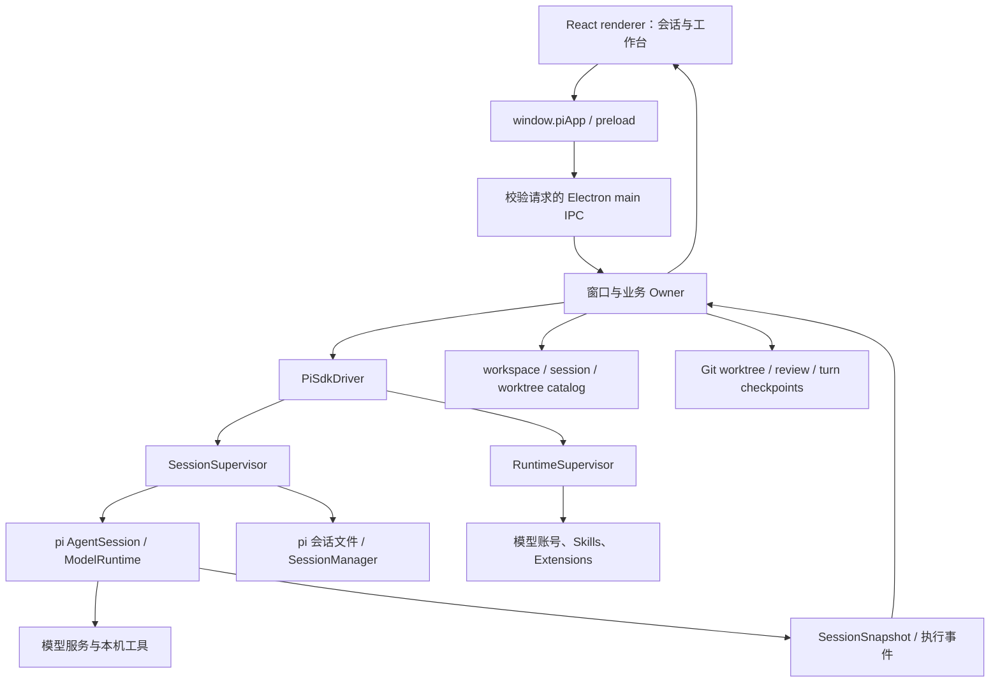

# Lancer 技术与复用研究

研究日期：2026-11-18。源码：[raylee-ai/lancer](https://github.com/raylee-ai/lancer)，固定到提交 [`0ccc4584fc0753fa128e71464814d1ed09dd1dbc`](https://github.com/raylee-ai/lancer/tree/0ccc4584fc0753fa128e71464814d1ed09dd1dbc)。本文结论来自该快照的 README、依赖声明和源码阅读，未安装运行上游应用，也未验证它的真实模型、原生功能和打包产物。

## 结论

Lancer 是基于 **pi-gui v1.0.1** 的个人 fork，定位为支持多模型会话、递归子任务、工作树和交付检查的桌面工作台。Agent 执行依赖 **pi coding agent SDK**；React 负责展示，Electron 主进程负责本机能力和状态所有权。它没有用一个网页聊天室替代本地 Agent 的执行。

最适合 AgentDesk 直接复用的是独立 **Light UI**，以及“按业务事件展示执行流向”的方式。团队开发仍应沿用 AgentDesk 的项目邀请、本机连接器、任务租约、独立 worktree、检查、交付和验收链路。将 Lancer 整个 Electron 宿主或 pi SDK 驱动搬进来，会引入第二套执行、数据和权限生命周期。

## 技术栈

以下是固定提交中的依赖声明；带 `^` 的版本不是对实际安装版本的声明。

| 层次       | 技术与声明版本                                                      | 职责                                                                    |
| ---------- | ------------------------------------------------------------------- | ----------------------------------------------------------------------- |
| 仓库       | pnpm 10.34.9 workspaces、Node >=22.19 <26、TypeScript ^5.9.3        | 多包构建，推荐 Node 24                                                  |
| 桌面宿主   | Electron 43.8.4、electron-vite 5、electron-builder 26.18.0          | 主进程、preload、原生窗口及安装包                                       |
| 界面       | React ^19.1.0、Vite 6.4.5、react-markdown、remark-gfm               | 会话、工作台、Markdown 与交付视图                                       |
| Agent      | `@earendil-works/pi-coding-agent ^1.4.0`                            | AgentSession、模型运行、工具和扩展生命周期                              |
| 模型适配   | pi-ai 生态，以及 OpenAI、Anthropic、Google、Bedrock、Mistral 等 SDK | 多服务商协议、账号与模型接入；不代表每种已实测                          |
| 会话契约   | `packages/session-driver`                                           | SessionDriver、快照、事件、运行时和 turn capture 契约                   |
| pi 适配    | `packages/pi-sdk-driver`                                            | PiSdkDriver、SessionSupervisor、RuntimeSupervisor                       |
| 目录存储   | `packages/catalogs`                                                 | workspace/session/worktree catalog；Node 实现为校验后的 JSON 与原子写入 |
| 扩展界面   | `packages/extension-ui`、Chord                                      | 本地扩展服务、状态和受限前端连接                                        |
| 光线       | `packages/light-ui`：TypeScript + SVG + CSS，无运行时依赖           | 锚点间光线、落点反馈和运行描边                                          |
| 本机工具   | Git worktree、node-pty                                              | 分支工作区与终端                                                        |
| 测试       | Playwright、Node test、架构边界 guard                               | 确定性测试、Electron UI、原生与真实 provider 分层验证                   |
| 官网／宣传 | Next.js 15.5.28；独立 `video/` 使用 Remotion                        | 官网和宣传视频，不属于桌面或光线 UI 的运行依赖                          |

来源：[根配置](https://github.com/raylee-ai/lancer/blob/0ccc4584fc0753fa128e71464814d1ed09dd1dbc/package.json)、[桌面配置](https://github.com/raylee-ai/lancer/blob/0ccc4584fc0753fa128e71464814d1ed09dd1dbc/apps/desktop/package.json)、[pi 驱动配置](https://github.com/raylee-ai/lancer/blob/0ccc4584fc0753fa128e71464814d1ed09dd1dbc/packages/pi-sdk-driver/package.json)、[官网配置](https://github.com/raylee-ai/lancer/blob/0ccc4584fc0753fa128e71464814d1ed09dd1dbc/apps/website/package.json)。

## Agent 架构与数据流

`DesktopAppStore` 是组合入口；conversation、workspace、orchestration、scheduled-task、review 等 Owner 各自拥有状态和能力。IPC 绑定发送窗口与明确会话目标，并校验请求。renderer 不直接导入 Node、Electron 或宿主实现。多窗口操作通过窗口 Owner 串行化，避免把一次操作写进另一个当前会话。

`SessionSupervisor` 管理执行会话、订阅、事件处理、持久化和租约等生命周期。`RuntimeSupervisor` 管理 workspace 的账号、模型、资源加载与启停。`SessionDriver` 把这些能力表示成可移植契约，避免界面直接绑定 pi 内部对象。少量依赖 pi 私有行为的代码单独放进 `compat/`，升级仍需要兼容性验证。

来源：[架构说明](https://github.com/raylee-ai/lancer/blob/0ccc4584fc0753fa128e71464814d1ed09dd1dbc/docs/architecture.md)、[PiSdkDriver](https://github.com/raylee-ai/lancer/blob/0ccc4584fc0753fa128e71464814d1ed09dd1dbc/packages/pi-sdk-driver/src/pi-sdk-driver.ts)、[SessionSupervisor](https://github.com/raylee-ai/lancer/blob/0ccc4584fc0753fa128e71464814d1ed09dd1dbc/packages/pi-sdk-driver/src/session-supervisor.ts)、[RuntimeSupervisor](https://github.com/raylee-ai/lancer/blob/0ccc4584fc0753fa128e71464814d1ed09dd1dbc/packages/pi-sdk-driver/src/runtime-supervisor.ts)。

### 并行开发、分支与回归

子任务由 orchestration Owner 管理，带父子关系、状态和执行证据。会话可使用独立 Git worktree 和 `lancer/<session-id>` 分支，分别开发后再检查和明确合并／丢弃。**worktree 隔离工作目录，不是操作系统沙箱**；工具仍使用宿主账号权限。

GitTree 展示的是任务／会话事件关系，不能把每个图节点都当成 Git commit。Review 区分未提交、暂存、分支和最后一轮；turn checkpoint 使用应用自有的独立 Git 对象库保存前后快照。重叠运行会记录重叠来源，不能据此把所有文件改动独占归因到某个 Agent。

这对团队开发的启发是：交付必须有固定提交和检查证据，集成回归应针对明确的交付 SHA。动态光线只能说明事件到达，不能代替测试通过或验收通过。

来源：[worktree manager](https://github.com/raylee-ai/lancer/blob/0ccc4584fc0753fa128e71464814d1ed09dd1dbc/apps/desktop/electron/platform/worktrees/worktree-manager.ts)、[session worktree](https://github.com/raylee-ai/lancer/blob/0ccc4584fc0753fa128e71464814d1ed09dd1dbc/apps/desktop/electron/platform/worktrees/session-worktree.ts)、[review 与 checkpoint](https://github.com/raylee-ai/lancer/blob/0ccc4584fc0753fa128e71464814d1ed09dd1dbc/docs/architecture.md#review-and-captured-turns)。

### 持久化、扩展与平台边界

pi 账号和会话资源使用 `~/.pi/agent`，应用界面状态使用 Electron userData；重新 clone 并不会隔离这些运行数据。catalog 使用 JSON backend，并对输入解码、按路径协调写入，不是一个团队共享数据库。

扩展后端遵循本地 pi 扩展信任路径；扩展前端使用受限 iframe、按连接分配的消息通道和受约束的资源协议。前端限制不能自动变成对本机扩展后端的权限沙箱。豆包接管涉及 macOS 原生 bridge 与辅助功能权限，不能把这部分当作可直接用于 Windows 的网页功能。

上游主要验证 macOS Apple Silicon。存在 Linux／Windows 打包配置，不等于本机原生能力均已验证。`evals/` 有 26 个 SWE-bench Lite 实例的评估流程，但仓库没有提供模型成绩；不能凭评测脚本推断能力排名。

## 仓库里的 Skills 有什么用

该快照中找到的 `SKILL.md` 共 **2 个**，均位于 `.agents/skills/`，服务于仓库开发验证。它们不等于运行时可加载的全部个人 Skills。

| Skill                     | 用途与触发场景                                                                                                                | 对 AgentDesk 的借鉴                                                     |
| ------------------------- | ----------------------------------------------------------------------------------------------------------------------------- | ----------------------------------------------------------------------- |
| `verify-pi-gui`           | 修改桌面行为后，使用真实 Electron UI 检查发送、流式回复、工具、停止、切换会话、草稿与重启持久化；真实 provider 验证是独立层级 | 将 UI、协议集成、真实模型和安装包验证分开记录，保留脱敏截图与 trace     |
| `testing-windows-desktop` | Windows 开发与验证经验：node-pty ABI 重建、默认 shell、无界面终端、目录对话框和快捷键差异                                     | 对现有 Windows 外壳与本机执行器单独验证，避免只测网页就声称原生能力正常 |

源码：[verify-pi-gui](https://github.com/raylee-ai/lancer/blob/0ccc4584fc0753fa128e71464814d1ed09dd1dbc/.agents/skills/verify-pi-gui/SKILL.md)、[testing-windows-desktop](https://github.com/raylee-ai/lancer/blob/0ccc4584fc0753fa128e71464814d1ed09dd1dbc/.agents/skills/testing-windows-desktop/SKILL.md)。本研究将它们作为资料阅读，没有执行其中的任务指令。

运行时的 **Skill** 是描述任务方法的 Markdown 资源；`RuntimeSupervisor` 从资源路径和 metadata 中读取名称、说明、来源、scope、启用状态及 slash command，交给 pi 的 resource loader 使用。**Extension** 则可以注册工具、命令、生命周期与自定义界面。两者有独立启停入口。Skill 提示词不能代替工具审批、路径限制或服务端鉴权。

AgentDesk 已有自己的技能目录、工具授权和运行引擎。可采用上述验证思路，当前不安装 Lancer 的开发 Skill，也不将它们宣传为新增业务能力。

## 「单独复用光线 UI」在 AgentDesk 的落地

上游 [Light UI](https://github.com/raylee-ai/lancer/tree/0ccc4584fc0753fa128e71464814d1ed09dd1dbc/packages/light-ui) 已把效果拆成可独立运行的库。当前在本仓库保留其核心源码为 [`@agentdesk/light-ui`](../packages/light-ui/README.md)，保留 MIT `LICENSE`、`NOTICE` 和上游来源。没有引入 Electron、pi SDK 或 Remotion。

| 接口／机制                            | 行为                                    | AgentDesk 接入点                             |
| ------------------------------------- | --------------------------------------- | -------------------------------------------- |
| `createLightLayer(root)`              | 在局部容器叠加不拦截点击的 SVG          | 编码协作图、团队任务执行面板                 |
| `emit({ id, source, target, color })` | 按真实锚点飞行，同色轨迹与落点反馈      | 新工具调用／结果／交付事件；团队新增执行上报 |
| `finished` / `cancel()`               | 区分 arrived、cancelled、missing-anchor | 锚点缺失不随机飞行；卸载销毁图层             |
| `pause()` / `resume()`                | 控制飞行生命周期                        | 暂停按钮、隐藏页面；历史加载不重放           |
| `light-running-border`                | 运行时的细描边                          | 运行中的 Agent、主控、当前任务和群聊生成气泡 |
| reduced motion                        | 尊重系统减少动态效果设置                | 保留静态状态，关闭飞行与跑动                 |

适配层对事件 ID 去重、单批数量及活跃光线数限流；不为逐 token 输出、时间流逝或未知状态制造业务事件。浏览器测试覆盖流向、暂停、减少动态效果及历史重载；几何测试沿用上游并保留出处。

## 与 AgentDesk 的区别及后续取舍

| 主题       | Lancer                                       | AgentDesk 当前路线                                                                        |
| ---------- | -------------------------------------------- | ----------------------------------------------------------------------------------------- |
| 桌面       | Electron main + preload                      | Tauri 2 + Node sidecar                                                                    |
| Agent 执行 | 完整 pi coding-agent SDK，会话驱动适配       | 自有 agent-core，使用 `@mariozechner/pi-ai` 模型层；外部 Codex／Claude 通过本机连接器接入 |
| 协作       | 单机多会话／递归任务／worktree               | 本机多 Agent + 独立 HTTPS 团队站 + 不同成员电脑                                           |
| 数据       | 本机 session files、JSON catalog 与 userData | sidecar SQLite、团队事件和任务租约                                                        |
| 光线       | 独立 SVG 事件层                              | 已复用核心，连接现有执行事件                                                              |
| 权限       | Electron IPC、宿主能力、扩展信任边界         | 本机审批、团队成员 ACL、租约、显式领取和验收                                              |

本轮优先完成可独立复用的光线与展示修复。后续值得单独立项的是更明确的会话驱动契约、按轮次的不可变文件检查，以及更完善的跨平台验证。递归调度、模型引擎替换、豆包原生接管和扩展 marketplace 都不属于本轮已实现的能力。

## CHANGELOG 与版本启发

Lancer 当前的 `CHANGELOG.md` 只有 `Unreleased — November 1 Alpha preparation`，并明确不代表已发布。AgentDesk 从本轮建立独立的 [`CHANGELOG.md`](../CHANGELOG.md) 和产品版本 `1.0.0-alpha.1`，Git tag 为 `v1.0.0-alpha.1`。界面／文档可展示为 `v1.0.0 (Alpha)`；括号不放进 SemVer 或 Git 发布标识。

CLI 的 `cli-v0.1.0`、`cli-v0.1.1` 历史与 npm 包版本保持独立。源码 tag、npm 包发布、签名桌面安装包和网站部署是不同结果，必须分别说明验证和发布状态。

## 许可

Lancer 和 pi-gui 源码为 MIT，复用部分保留原版权声明。模型商标、角色素材、用户头像和视频素材不因此获得再分发许可；本轮没有复制这些素材。Remotion 有自己的许可，但不是本次复用组件的依赖。AgentDesk 根项目的许可状态不因加入这个 MIT 子包而改变。
