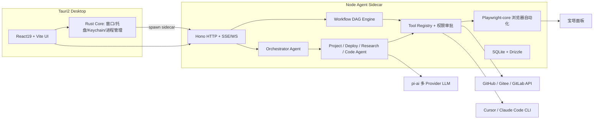

# 个人 Agent 工作台（暂名 AgentDesk）

## 1. 项目位置与总体架构

新项目放在 `D:\agent\AgentDesk`，与 [DevFlow-AI](D:\agent\DevFlow-AI) 平级，名字可以再换。采用 pnpm workspaces + Turborepo 的 monorepo 结构。

目录结构：

- `apps/desktop`：Tauri 2 外壳（`src-tauri` 用 Rust）加 React 前端
- `apps/sidecar`：Node Agent 运行时，用 `bun build --compile` 打包成 Tauri sidecar 二进制
- `packages/agent-core`：Agent 循环、多 Agent 编排、工具协议，参考 pi-mono 的 `pi-agent-core` 和 `pi-ai`
- `packages/workflow`：工作流 DSL（Zod schema）、节点注册表、DAG 执行器
- `packages/integrations`：GitHub（Octokit）、Gitee v5、GitLab v4、热榜抓取、宝塔浏览器操作配方
- `packages/ui`：设计系统，基于 shadcn/ui + Tailwind v4 + Radix
- `packages/shared`：类型定义、Zod 契约、错误码

## 2. 从 DevFlow 借鉴的部分（思路复用，不直接拷贝 Python 代码）

- [backend/app/services/agents](D:\agent\DevFlow-AI\backend\app\services\agents)：Planner、专用 Agent、Observer、Synthesis 的闭环，改写成 TS 版 Orchestrator
- [backend/app/skills](D:\agent\DevFlow-AI\backend\app\skills)：`SKILL.md` 按需加载机制，原样沿用格式
- `permissions.py` 和 safety-draft：危险操作（部署、push）先生成 ActionDraft，人工确认后才执行
- `worktree_manager.py`、`scheduler.py`、`context_compression.py`、`memory_hub.py`：对应实现 TS 版本

## 3. AI Key 与 Provider 管理

- 在设置页提供"导入"向导，有两种来源：
  - 选择 `D:\AI agent\langsmith\.env` 文件，识别 `*_API_KEY`、`*_BASE_URL`、`*_MODEL` 这类 OpenAI 兼容配置
  - 读取 CC Switch 的本地配置（`~/.cc-switch` 下的 db 或 json 文件），导入 Claude 中转站的 key 和 url
- 只读导入，用户勾选后才保存。密钥存进 Windows 凭据管理器（Rust `keyring` crate），SQLite 只保存引用 ID，不保存明文。
- 用 pi-ai 统一调用 Anthropic、OpenAI 兼容接口和中转站。每个 Agent 可以单独选模型，并配置备用 Provider，主 Provider 失败时自动切换。

## 4. 功能模块（对应侧边栏页面）

1. **Bot 首页 / 对话**：采用 Grok bot 风格，深色优先、中心输入框、流式输出、工具调用卡片、`Ctrl+K` 命令面板（cmdk）。Orchestrator 识别意图后，路由给以下专用 Agent：
   - ProjectAgent：查询项目、仓库状态
   - DeployAgent：执行部署
   - ResearchAgent：热榜和技术学习
   - CodeAgent：调起 Cursor 或 Claude Code
2. **项目中心**：
   - 扫描本地目录下的 `.git`，按 remote 地址自动识别平台（GitHub、Gitee、自建 GitLab）
   - 聚合显示分支、未提交改动、最近提交、PR/MR
   - 一键 `cursor <path>`；一键在 Windows Terminal 中执行 `claude`
   - 读取 `~/.claude/projects` 展示 Claude Code 会话历史
3. **部署中心（浏览器自动化）**：
   - 服务器档案保存宝塔地址、安全入口和账号（密码存在 keychain）
   - 用 Playwright-core 驱动系统自带的 Edge 或 Chrome，每个面板一个 persistent context，登录态可以复用。首次登录或遇到验证码时弹出有头窗口，由你手动完成。
   - 部署配方按项目分别配置，例如 IM 项目：登录、打开终端或文件管理、执行 `git pull` 和构建、在 Node/Java 项目管理里重启、检查健康接口
   - 每一步都截图并记录日志，失败时可以从断点重试。正式执行前必须人工确认。
   - 风险提示：宝塔改版会导致选择器失效，所以配方要支持重新录制，并在选择器失效时用视觉模型兜底定位
4. **每日热榜 Feed**：
   - 定时抓取 GitHub Trending（按日/周，可选语言）、Hugging Face Trending、Hacker News，并可扩展其他源
   - LLM 去重、打标签（AI、前端、后端），每条生成一句话中文摘要，每天生成一份"今日速览"
   - 卡片式时间线，支持收藏，并可以"让 Bot 深入讲解"
5. **工作流（类似扣子）**：
   - 用 React Flow（`@xyflow/react`）做画布
   - 节点类型：开始/结束、LLM、Agent、工具、条件、循环、HTTP、Shell、Git、浏览器配方、人工审批、通知
   - 工作流用 JSON DSL 描述并做版本管理。可以手动触发、定时触发，或在对话中由 Bot 调用。
   - 执行过程实时高亮节点，可以查看每个节点的输入和输出
   - 内置模板："拉代码、构建、宝塔部署、健康检查、通知"和"每日热榜摘要"
6. **设置**：Provider、Git 平台 Token、服务器档案、Skills、主题。

## 5. 工程规范（对标大厂）

- TypeScript `strict`，ESLint flat config + Prettier，Rust 用 `clippy` 和 `rustfmt`
- husky + lint-staged + commitlint（Conventional Commits），Changesets 管理版本
- 测试：Vitest 做单元测试，Playwright 做 E2E，工作流引擎和 Agent 路由要有契约测试
- 分层：UI、领域服务、集成适配器；所有跨进程接口都用 Zod 契约，前端通过 TanStack Query 访问
- 状态管理：Zustand 管 UI 状态，TanStack Router 管路由
- 可观测性：Agent 和工作流 trace 写入 SQLite，界面可以回放
- 安全：Tauri capabilities 只开放最小权限；Shell 和浏览器类工具分为白名单和需审批两类

## 6. 分阶段交付

- **P0 脚手架**：monorepo、Tauri 拉起 sidecar、设计系统与布局、Provider 导入和 keychain
- **P1 项目中心**：本地扫描、三个 Git 平台适配、Cursor 和 Claude Code 启动
- **P2 Bot 与多 Agent**：agent-core、Orchestrator、工具注册与审批、对话 UI
- **P3 热榜 Feed**：抓取器、调度器、LLM 摘要、Feed UI
- **P4 部署中心**：服务器档案、Playwright 宝塔配方、IM 项目首个配方、截图日志
- **P5 工作流**：DSL、执行器、React Flow 画布、模板、让 Bot 调用工作流
- **P6 打磨**：托盘和通知、自动更新、Windows 安装包、E2E 测试
